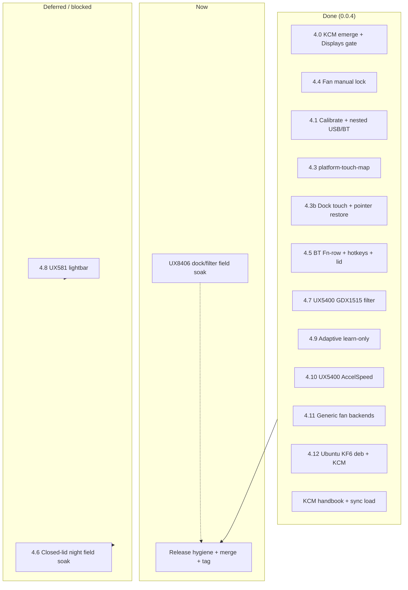

# Roadmap — zenbook_scripts / platform tools

Status legend: **done** · **now** · **next** · **later**

## Where we are (2026-08)

| Area | Status | Notes |
|------|--------|--------|
| Docked UX8406 backlight + Fn chords | **done** | `kb-brightness`, oot `hid-asus`, hotkeys; [`README.fn_row_policy.md`](README.fn_row_policy.md) |
| ScreenPad (UX5400) | **done** | `screenpad*`; configure path fix for `/usr/share` |
| ACPI `platform_profile` CLI | **done** | `kb-platform-profile` |
| Fan RPM + auto/full PWM | **done** | `platform-fan` (`kb-fan` wrapper) |
| Adaptive AC/battery/lid/sleep daemon | **done** | `platform-fan-control` + JSON; OpenRC `-c` order fixed |
| Machine-global config (not per-user) | **done** | `/etc/zenbook-scripts/fan-control.json` |
| Capability probe / dry-run | **done** | `platform-probe` (`--json` / `--feature` / `--recommend-use`) |
| Qt6 tray + thermal metrics | **done** | `platform-tray` / `platform-metrics` — **validated UX5400** |
| Touchpad palm filter MVP | **done** | per-device profiles + Qt6 tuner; UX8406 primary |
| Touchpad typing-inhibit + soft-accel | **done** | shipped in **0.0.2**; soft_accel default off unless enabled |
| Plasma KCM + PowerDevil / session | **done** (0.0.3) | `platform-session` + KCM MVP; tag `v0.0.3` |
| Gentoo KCM via `USE=plasma` | **done** | emerge builds/installs KCM; Displays tab gated |
| Touchpad GUI calibrate (capture → knobs) | **done** | Guided sequences + nested USB/BT profiles |
| UX5400 GDX1515 cursor jumps | **done** | PR [#13](https://github.com/f0xx/zenbook_scripts/pull/13) |
| UX8406 dual-eDP touch (Plasma/Wayland) | **done** | `platform-touch-map`; undocked ELAN9008→eDP-1, ELAN9009→eDP-2 |
| UX8406 docked touch map | **done (tree)** | `platform-touch-map apply-docked` → both ELAN → eDP-1 when keyboard docked |
| UX8406 dock BT↔USB touchpad handoff | **done (tree)** | `platform-duo-dock` + udev: stop filter, `restore-kwin`, optional OpenRC restart |
| KWin pointer touchpad restore | **done (tree)** | `restore-kwin` re-enables Primax/i2c pads (`touch=false` in KWin) |
| KCM help + load-on-open | **done (tree)** | Handbook HTML/docbook; probe/displays/touchpad status sync on `load()` |
| Adaptive filter (learn-only) | **done (tree)** | Typing-gated `adaptive_matrix`; no position rewrite; nested transport config |
| Touchpad config precedence | **done (tree)** | `transports.usb`/`.bluetooth` beats stale flat `name\|phys` keys |
| Closed-lid **night** profile (AC) | **scaffold** | `platform-night-mode` + elogind drop-in; see §4.6 |
| Generic non-ASUS fan backends | **done (tree)** | `fan_hwmon.py` — thinkpad / dell / hp / pwm |
| UX5400 AccelSpeed polish | **done (tree)** | `touchpad.json.example.ux5400` nonlinear soft_accel |
| Ubuntu KF6 / KCM `.deb` | **done (tree)** | `zenbook-scripts-plasma` via `packaging/debian/build-kcm.sh` |
| UX581 lightbar (HID `0b05:0124`) | **later** | **blocked on hardware**; side branch `zenbook_ux581` |
| **0.0.4 tag + merge to main** | **done** | Tagged `v0.0.4` 2026-08-07 |

## After **0.0.3** — **0.0.4** RC

| # | Track | Status | Intent |
|---|--------|--------|--------|
| 4.0 | **KCM in emerge + Displays gate** | **done** | `USE=plasma` builds KCM; tab gated by Duo/ScreenPad. |
| 4.1 | **Touchpad Calibrate deepen** | **done** | Guided sequences, analyzer, nested USB/BT transports. |
| 4.2 | **`docs/` research library** | **seeded** | [`docs/README.md`](docs/README.md) |
| 4.3 | **Dual-eDP touch map** | **done** | `platform-touch-map`; undock + session `touch_map_apply`. |
| 4.3b | **Duo dock touch + touchpad handoff** | **done (tree)** | Docked panel map; BT↔USB cursor unfreeze — see §4.3b. |
| 4.4 | **Fan manual lock** | **done** | Tray/CLI sticky profile + `fan-control-mode`. |
| 4.5 | **BT Fn-row + hotkeys robustness** | **done** | Vendor `0x3d`→F4; dock transitions; `zenbook-kb-lid` OpenRC quiet stop. |
| 4.6 | **Closed-lid night (AC server)** | **scaffold** | `platform-night-mode`; enable in `night-mode.json`. |
| 4.7 | **UX5400 GDX1515 live filter** | **done** | PR [#13](https://github.com/f0xx/zenbook_scripts/pull/13). |
| 4.8 | **UX581 lightbar** | **blocked** | Hardware-gated; `zenbook_ux581`. |
| 4.9 | **Adaptive touchpad filter** | **done (tree)** | Learn-only, typing-gated; KCM profile selector — see §4.9. |
| 4.10 | **UX5400 AccelSpeed polish** | **done (tree)** | GDX1515 nonlinear preset + doc. |
| 4.11 | **Generic fan backends** | **done (tree)** | `fan_hwmon.py`. |
| 4.12 | **Ubuntu KF6 `.deb` + KCM** | **done (tree)** | `zenbook-scripts-plasma`. |
| — | **Release hygiene** | **done** | CHANGELOG, Gentoo `0.0.4` ebuild, merge → `main`, tag `v0.0.4`. |

### 4.3b Duo dock: touchscreens + keyboard touchpad (2026-08)

**Symptom:** Undocked touch OK; **dock keyboard back** → lower-panel touch wrong and/or **cursor frozen** on USB Primax pad.

**Root causes (fixed in tree):**

1. **Touchscreens:** eDP-2 disabled on dock but saved map still had ELAN9009→eDP-2.
   → `platform-touch-map apply-docked` maps both ELAN digitizers → **eDP-1**.
2. **Pointer touchpad:** Live filter (or prior session) left KWin **`enabled=false`**
   on the new USB `eventN` node. KWin classifies keyboard touchpads as pointer
   (`touch=false`), so old `restore-kwin` skipped them.
   → `restore_all_compositor_touchpads()` + `list_pointer_touchpads()`;
   `platform-touchpad restore-kwin`; wired from `platform-duo-dock` and udev.

**Operator recovery:**

```bash
platform-touchpad stop
platform-touchpad restore-kwin
platform-touch-map apply-docked    # when USB pogo docked
platform-touch-map apply           # when undocked / BT
```

**Caution:** Keep live filter **off** until USB raw pad is stable after dock.
OpenRC `zenbook-platform-touchpad` restart on handoff is optional — only if you
already run the service.

### 4.9 Adaptive filtering (done in tree — field soak pending)

**Profiles:** `default` (static outlier chain) vs `adaptive` (`adaptive_matrix`).

**Shipped behaviour (Aug 2026):**

- Adaptive runs **only during typing-inhibit window** (same gate as outlier).
- **Learn-only** — no frame drop, no position rewrite (fixes sticky cursor).
- State under `~/.config/zenbook-scripts/adaptive-touchpad/`.
- KCM + nested `transports.usb` / `.bluetooth` in `touchpad.json`.

**Still to validate:** UX8406 long-session soak with live filter **on** after
dock handoff fixes; optional re-enable attenuation behind a knob if palm glitches
return without sticky side effects.

See [`docs/touchpad/adaptive-filtering.md`](docs/touchpad/adaptive-filtering.md).

### 4.6 Closed-lid night profile (scaffold)

Opt-in: `platform-night-mode`, `night-mode.json`, elogind drop-in.
Not mandatory for 0.0.4 tag.

### 4.10–4.12 (done in tree)

- **4.10:** `touchpad.json.example.ux5400`, `docs/touchpad/ux5400-accel.md`
- **4.11:** `zenbook_kb/fan_hwmon.py`
- **4.12:** Debian `zenbook-scripts-plasma` build script

### Release gate (0.0.4) — **shipped 2026-08-07**

```text
feature/adaptive-touchpad-filter ─► merge main ─► tag v0.0.4
```

Field validation: UX5400 GDX1515 live filter (motion); UX8406 dock handoff (tree).
KCM full pass still open (Help, Displays, Start/Stop live filter).

## Gentoo USE mapping

| USE | Installs |
|-----|----------|
| `hotkeys` | brightness hotkeys, lid/sleep |
| `fan_control` | `platform-fan*`, OpenRC, probe hooks |
| `screenpad` | UX5400 ScreenPad |
| `kernel` | oot hid-asus (build from sources; fail-closed preflight) |
| `qt6` | `configure_gui.py`, `platform-tray`, `platform-touchpad-gui` |
| `plasma` | `platform-session`, Duo/ScreenPad CLIs, sleep hook, **KCM** (KF6) |

```bash
platform-probe                  # human dry-run
platform-probe --json           # emerge / scripts
platform-probe --feature fan_pwm
platform-probe --recommend-use
```

## 0.0.4 dependency graph



## Component sketch

```
platform-probe ──────────────► install decisions (USE / configure flags)
       │
       ├─► platform-duo-dock ──► kscreen eDP-2 + touch-map + touchpad handoff
       │         └─► udev 99-zenbook-duo-dock.rules
       │
       ├─► platform-touch-map ──► KWin outputName (screens + restore-kwin pads)
       │
       ├─► platform-touchpad ──► EVIOCGRAB + uinput filter chain
       │         ├─ default: typing_inhibit → exec_delay → outlier → soft_accel
       │         └─ adaptive: typing-gated adaptive_matrix (learn-only)
       │
       ├─► platform-fan-control ─► platform-fan / platform-power
       │
       └─► platform-tray / KCM (USE=plasma)
                 └─► platform-touchpad-gui / platform-touchpad-kcm

screenpad* (UX5400)          zenbook-kb-lid / zenbook-kb-hotkeys (OpenRC)
contrib/udev/99-uinput.rules   optional: /dev/uinput group for user-started filter
```

## After **0.0.4** — **next**

| Track | Intent |
|-------|--------|
| Live filter + dock automation | SIGHUP transport switch or safe auto-restart only when filter was running |
| KCM live sparkline | Touchpad tab ΔX/ΔY monitor (noted in KCM UI) |
| Packaging maintainers | Debian/Alpine VM build notes in `packaging/MAINTAINERS.md` |
| UX581 lightbar | HID feature reports when hardware available |
| Plasma resume watcher | QSG thread threshold auto-`plasmashell --replace` (session.json) |

Contributor research: [`docs/`](docs/README.md). See also [PLANNED.md](PLANNED.md) and [CHANGELOG.md](CHANGELOG.md).
