# Roadmap — zenbook_scripts / platform tools

Status legend: **done** · **now** · **next** · **later**

## Where we are (2026-07)

| Area | Status | Notes |
|------|--------|--------|
| Docked UX8406 backlight + Fn chords | **done** | `kb-brightness`, oot `hid-asus`, hotkeys; [`README.fn_row_policy.md`](README.fn_row_policy.md) |
| ScreenPad (UX5400) | **done** | `screenpad*`; oneshot OpenRC stop fixed |
| ACPI `platform_profile` CLI | **done** | `kb-platform-profile` |
| Fan RPM + auto/full PWM | **done** | `platform-fan` (`kb-fan` wrapper) |
| Adaptive AC/battery/lid/sleep daemon | **done** | `platform-fan-control` + JSON; OpenRC `-c` order fixed |
| Machine-global config (not per-user) | **done** | `/etc/zenbook-scripts/fan-control.json` |
| Capability probe / dry-run | **done** | `platform-probe` (`--json` / `--feature` / `--recommend-use`) |
| Rename away from `kb-fan` | **done** | `platform-fan*`; wrappers remain |
| Qt6 tray + thermal metrics | **done** | `platform-tray` / `platform-metrics` — **validated UX5400** |
| Source-only oot hid-asus | **done** | preflight + `USE=kernel` / `--with-kernel` (no prebuilt `.ko`) |
| Non-interactive sudo | **done** | `sudo -n` via `zenbook_kb/priv.py` + lib helpers |
| Vendor-agnostic install hints | **done** | probe → Gentoo USE recommendations |
| EPP / RAPL in fan-control profiles | **done** | `epp` / `rapl` / `intel_pstate` + `platform-power` |
| Touchpad palm filter MVP | **done** | per-device profiles + Qt6 tuner; UX8406 primary |
| Touchpad typing-inhibit + soft-accel | **done** | shipped in **0.0.2** |
| Package / announce **0.0.2** | **done** | tag + published release + Gentoo Manifest/ebuild |
| Plasma KCM + PowerDevil / session | **done** (0.0.3) | `platform-session` + KCM MVP; tag `v0.0.3` |
| Ubuntu `.deb` + packaging checks | **done** (CLI) | Smoke-built on Ubuntu 24.04 Server (augury1); KF6/KCM not in Noble |
| Alpine `apk` + packaging rules | **done** (smoke) | APK built on cast04 |
| Contributor research library | **done** (seed) | [`docs/`](docs/README.md) — Fn-row RE, daemon atlas, Duo/session/touchpad |
| Gentoo KCM via `USE=plasma` | **done** (tree) | emerge builds/installs KCM; Displays tab gated |
| Touchpad GUI calibrate (capture → knobs) | **now** | Guided type/palm/mixed shipped; BT transport profiles + field table remain |
| UX8406 dual-eDP touch (Plasma/Wayland) | **now** | **`platform-touch-map`** field-validated (ELAN9008→top, ELAN9009→bottom); commit + docs |
| Closed-lid **night** profile (AC, no suspend) | **likely 0.0.4** | Optional — intercept lid→suspend before Plasma/PowerDevil/elogind; see §4.6 |
| UX5400 GDX1515 cursor jumps | **done** | PR [#13](https://github.com/f0xx/zenbook_scripts/pull/13) — live filter + grab safety; was mislabeled “WM/DE” |
| UX581 lightbar (HID `0b05:0124`) | **later** | **blocked on hardware**; side branch `zenbook_ux581` |
| UX5400 AccelSpeed polish | **later** | same pipeline; lower priority than UX8406 |
| Generic non-ASUS fan backends | **later** | thinkpad/hp/dell hwmon profiles |
| Ubuntu KF6 / KCM `.deb` | **later** | needs 26.04+ or Kubuntu KF6 stack |

## After **0.0.3** — next RC (**0.0.4**)

| # | Track | Status | Intent |
|---|--------|--------|--------|
| 4.0 | **KCM in emerge + Displays gate** | **done** | `USE=plasma` builds KCM; tab gated by Duo/ScreenPad. |
| 4.1 | **Touchpad Calibrate deepen** | **mostly done** | Guided sequences + analyzer + apply/restart shipped; nested USB/BT profiles + operator field table remain. |
| 4.2 | **`docs/` research library** | **seeded** | Expand as RE continues; see [`docs/README.md`](docs/README.md). |
| 4.3 | **Dual-eDP touch map** | **field OK** | `platform-touch-map` (KWin `outputName` + `kcminputrc` `OutputUuid`); preset corrected on UX8406. Tag after commit. |
| 4.4 | **Fan manual lock** | **done (tree)** | Tray/CLI sticky profile + `fan-control-mode`; validated UX5400. |
| 4.5 | **BT Fn-row + hotkeys robustness** | **done (tree)** | Vendor `0x3d`→F4; hotkeys survives BT↔dock transition; pidfile for non-root OpenRC. |
| 4.6 | **Closed-lid night (AC server)** | **likely, not mandatory** | Lid down ≠ suspend on AC: blank displays, quiet fan, min CPU, network stays up; restore on lid open. See below. |
| 4.7 | **UX5400 GDX1515 live filter** | **done (main)** | PR [#13](https://github.com/f0xx/zenbook_scripts/pull/13): sporadic jumps over long sessions → `exec_delay` + `outlier_reject`; `--force` gate; UX5400 install seeds GDX1515 profile. |
| 4.8 | **UX581 lightbar** | **blocked** | Hardware-gated; `zenbook_ux581`. |
| — | **Release hygiene** | **open** | Commit/push unreleased tree, sync CHANGELOG, Gentoo `9999`, operator redeploy notes. |

### 4.6 Closed-lid night profile (idea — likely 0.0.4, optional)

**Goal:** On **AC power**, closing the lid does **not** suspend. Instead apply a
**night** profile: panel(s) off, keyboard backlight off, fan quiet / powersave,
CPU/EPP minimum, **network stays up**. Lid open restores the prior thermal +
display state (same persistence pattern as fan manual lock / saved profile).

**Why it is not “just PowerDevil”:** Lid-close usually propagates as suspend
through **elogind** (`HandleLidSwitch`) and/or **Plasma PowerDevil** before our
daemons run. We need to **intercept or override** that path early (session hook,
elogind drop-in, or inhibit) so suspend never starts; then apply our own
`lid_close` actions via `platform-session` / `platform-fan-control` /
`kb-brightness-sleep` (already have lid events — today they assume sleep follows).

**Likely integration points:**

| Layer | Role |
|-------|------|
| elogind / logind | `HandleLidSwitchExternalPower=ignore` (or `lock`) — stop kernel/session suspend on AC |
| PowerDevil / KCM | Lid closed → **Turn off screen** (not Suspend) when on AC |
| `zenbook-kb-lid` / `kb-brightness-lid-watch` | Already watches `LidClosed`; extend for night vs sleep |
| `platform-fan-control` | `events.lid_close` → night profile; `lid_open` → restore saved manual/auto |
| `platform-session` | Per-user `session.json` profile: `on_lid_close` / `on_lid_open` action lists |
| Duo | Optional: disable eDP-2 in night mode when undocked |

**Not mandatory for 0.0.4 tag** — document + spike is enough if time is short;
full implementation can slip to 0.0.5 without blocking release.

### 4.7 UX5400 GDX1515 live filter (shipped — PR #13)

**Symptom:** integrated **GDX1515** pad on UX5400EA — sporadic cursor jumps that
build up over long Plasma sessions; reboot was the only relief without filtering.
Looked like a WM/compositor bug; root cause is pad glitches, not KWin.

**Shipped (`fix/touchpad-live-filter-safety` → main):**

- GDX1515 whitelisted for live filter (no `--force`); `touchpad.json.example.ux5400`
  seeded on UX5400 install
- `live_filter_refusal_reason()` + CLI/GUI `--force` for unknown pads
- Grab recovery docs + `platform-touchpad stop`; GUI profile off by default
- `install.py` global fix for platform-profile boot paths

Optional follow-up: long-session soak on UX5400; enable `zenbook-platform-touchpad`
OpenRC if you want always-on.

Visual roadmap: Cursor canvas `platform-roadmap.canvas.tsx` (toward 0.0.4) — optional; see dependency graph below.

## After **0.0.2** — shipped as **0.0.3** (`feature/plasma-kcm-powerdevil`)

| # | Track | Intent |
|---|--------|--------|
| 3.1 | **Plasma KCM + PowerDevil / session** | **Shipped in 0.0.3.** |
| 3.2 | **Ubuntu / Debian** | **CLI `.deb` smoke on 24.04.** |
| 3.3 | **Alpine** | **APK smoke on cast04.** |
| 3.4 | **UX5400 GDX1515 jumps** | Shipped in 0.0.4 prep via PR [#13](https://github.com/f0xx/zenbook_scripts/pull/13) (was “WM/DE TBD”). |
| 3.5 | **UX581 lightbar** | Still blocked on hardware. |

## Gentoo USE mapping

| USE | Installs |
|-----|----------|
| `hotkeys` | brightness hotkeys, lid/sleep |
| `fan_control` | `platform-fan*`, OpenRC, probe hooks |
| `screenpad` | UX5400 ScreenPad |
| `kernel` | oot hid-asus (build from sources; fail-closed preflight) |
| `qt6` | `configure_gui.py`, `platform-tray`, `platform-touchpad-gui` |
| `plasma` | `platform-session`, Duo/ScreenPad CLIs, sleep hook, **KCM** (KF6) |

```bash
platform-probe                  # human dry-run
platform-probe --json           # emerge / scripts
platform-probe --feature fan_pwm
platform-probe --recommend-use
```

## 0.0.4 dependency graph

Legend: **solid** = shipped or in tree · **dashed** = optional / deferred · **blocked** = needs hardware

```mermaid
flowchart TB
  subgraph done ["Done (0.0.4)"]
    KCM["4.0 KCM emerge + Displays gate"]
    FANLOCK["4.4 Fan manual lock"]
    CAL["4.1 Calibrate guided capture"]
    TOUCH["4.3 platform-touch-map"]
    FNROW["4.5 BT Fn-row + hotkeys fix"]
    GDX["4.7 UX5400 GDX1515 filter"]
  end

  subgraph open ["Open for tag"]
    REL["Release hygiene<br/>commit · CHANGELOG · 9999"]
    DOCS["4.2 docs expand"]
    CAL2["4.1 BT transport profiles<br/>field table"]
  end

  subgraph likely ["Likely 0.0.4 — optional"]
    NIGHT["4.6 Closed-lid night<br/>block suspend on AC"]
  end

  subgraph defer ["Deferred / blocked"]
    UX581["4.8 UX581 lightbar"]
  end

  KCM --> REL
  FANLOCK --> REL
  CAL --> CAL2
  CAL --> REL
  TOUCH --> REL
  FNROW --> REL
  GDX --> REL
  DOCS -.-> REL

  NIGHT -.->|needs| SESS["platform-session"]
  NIGHT -.->|needs| LID["kb-lid / elogind"]
  NIGHT -.->|needs| FAN["platform-fan-control lid_*"]
  SESS --> NIGHT
  LID --> NIGHT
  FAN --> NIGHT

  UX581 -.-> defer
```



**Brief task blurbs**

| ID | Task | Depends on | Notes |
|----|------|------------|-------|
| 4.0 | KCM in emerge | KF6, `USE=plasma` | **Done** — no manual `build.sh` on emerge |
| 4.1 | Calibrate deepen | `platform-touchpad` capture, GUI | **Mostly done** — USB/BT nested keys optional |
| 4.2 | Docs library | contributor RE | Seeded; grow incrementally |
| 4.3 | Dual-eDP touch | KWin D-Bus, `kcminputrc` | **Field OK** on UX8406; swap preset in tree |
| 4.4 | Fan manual lock | tray, fan-control, `/var/lib` | **Done** — UX5400 validated |
| 4.5 | BT keyboard path | bt-fn-row, hotkeys, pidfile | **Done** — dock + undock transitions |
| 4.6 | Closed-lid night | elogind ignore, session, fan lid events | **Likely, not mandatory** — see §4.6 |
| 4.7 | UX5400 GDX1515 live filter | PR #13, `platform-touchpad` | **Done** — optional UX5400 soak |
| 4.8 | UX581 lightbar | HID `0b05:0124` HW | Blocked |
| — | Release | all committed tracks | Tag `v0.0.4` when ready |

## Dependency sketch (components)

```
platform-probe ──────────────► install decisions (USE / configure flags)
       │
       ├─► platform-fan ◄──── asus-nb-wmi OR generic pwm hwmon
       │         ▲
       │         │
       └─► platform-fan-control ─► platform_profile + platform-fan
                    │                      │
                    │                      └─► platform-power (EPP/RAPL/pstate)
                    │                                 ▲
                    │                                 │ profile JSON keys
                    ▼                                 │
              platform-tray (qt6) ────────────────────┘
                    │
                    ├─► metrics SQLite graph  (validated UX5400)
                    ├─► platform-touchpad-gui ──► platform-touchpad
                    │         │                         │
                    │         │                         ├─ typing-inhibit
                    │         │                         ├─ exec-delay
                    │         │                         ├─ outlier-reject
                    │         │                         └─ soft-accel
                    │         └─ per-device touchpad.json v2
                    │
                    └─► (done) announced 0.0.2
                              └─► (done) 0.0.3 Plasma KCM + session + Duo BT
                              └─► (now) 0.0.4: touch-map · fan lock · calibrate · BT fixes
                              └─► (likely opt) closed-lid night on AC
                              └─► (later) UX581 · Ubuntu KF6

screenpad* / zenbook-screenpad (oneshot)     UX5400 only
screenpad-sync (daemon)                      optional brightness mirror
```

Contributor research: [`docs/`](docs/README.md). See also [PLANNED.md](PLANNED.md) and [CHANGELOG.md](CHANGELOG.md).
